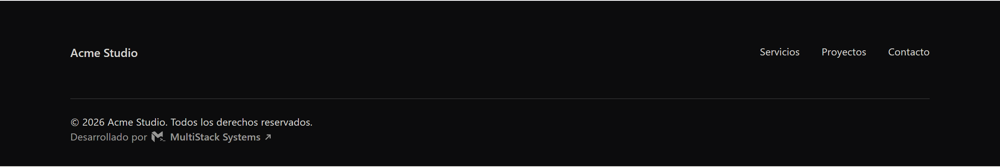
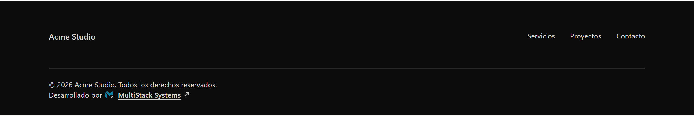
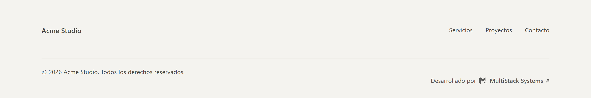
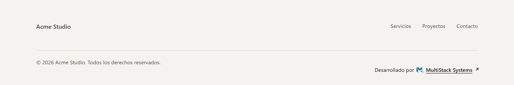
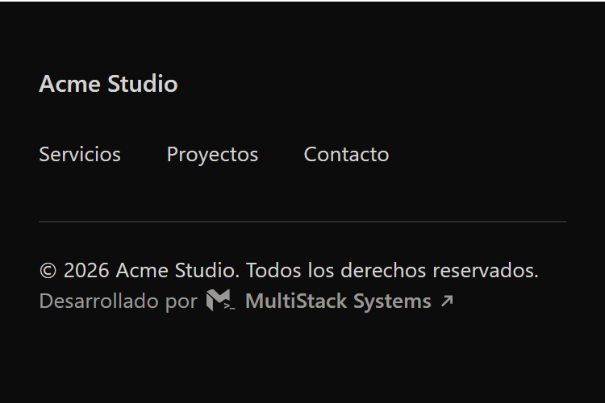
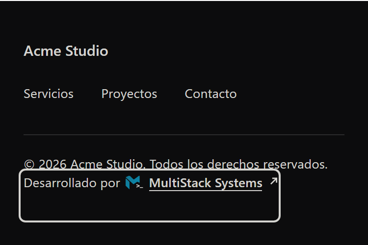
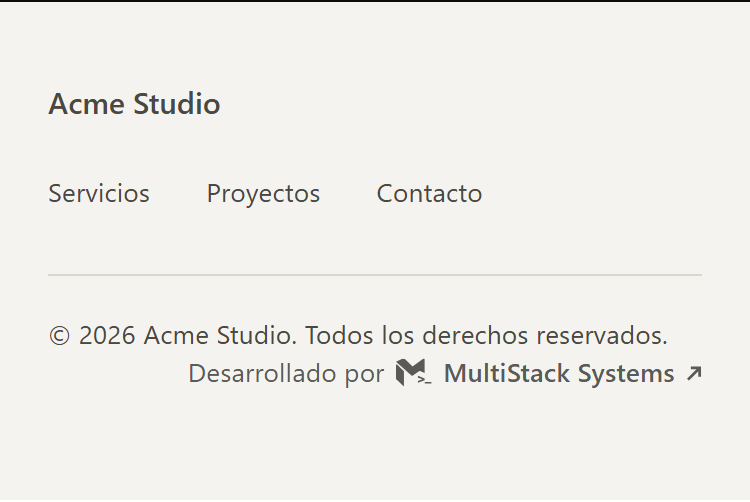
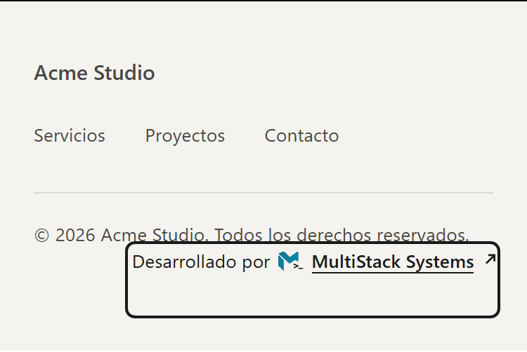

# Crédito «Desarrollado por MultiStack Systems»

Estándar del crédito de pie de página de los sitios que desarrolla MultiStack Systems. Texto visible:

> Desarrollado por [isotipo] MultiStack Systems ↗

El código está en [`snippets/credito-multistack/`](../../snippets/credito-multistack/). Este documento y esa carpeta bastan para ponerlo en un sitio nuevo.

## 1. Qué es y para qué sirve

Una línea discreta al final de cada web que desarrolla MultiStack. Sirve para que la marca se vea en el trabajo terminado y para llevar visitas a multistacksystems.com, medidas con UTM. **No es una táctica de SEO**: el enlace va con `nofollow` y no se busca que transmita autoridad (sección 7).

Se integra con el diseño del cliente y no compite con su marca. En reposo es texto del color del pie con opacidad reducida; el detalle de marca aparece solo al interactuar.

**Antes de publicarlo, el crédito debe estar acordado con el cliente en la cotización.** Si no consta, no se pone.

## 2. La carpeta del snippet

| Archivo | Qué es |
| --- | --- |
| `DevCredit.tsx` | Componente React. Server Component: sin estado ni efectos; vale para Next (App Router) y Vite. |
| `DevCredit.module.css` | Sus estilos (CSS Module). |
| `credito.html` | Demo estática. El bloque a copiar está entre los comentarios `CRÉDITO MULTISTACK: INICIO` y `FIN`; el resto de la página es solo de la demo. |
| `credito.css` | Estilos de la versión estática. |
| `isotipo-multistack.svg` | El isotipo suelto, de referencia. En el crédito el SVG ya va inline: no se enlaza. |

La versión React y la estática son la misma pieza (mismo marcado, mismas custom properties). Si cambias una, cambia la otra.

## 3. Instalación

### React

1. Copia `DevCredit.tsx` y `DevCredit.module.css` a la misma carpeta de componentes del sitio.
2. Ponlo en la barra inferior del footer (ejemplo: cliente `acme`, pie oscuro):

```tsx
import { DevCredit } from './DevCredit'

<DevCredit clientSlug="acme" tone="dark" align="start" className={styles.devCredit} />
```

`styles.devCredit` es una clase del propio sitio que lo coloca en su layout (sección 4).

| Prop | Tipo | Por defecto | Qué hace |
| --- | --- | --- | --- |
| `clientSlug` | `string` (obligatoria) | — | Va en `utm_source` del enlace (pasa por `encodeURIComponent`). |
| `align` | `'start' \| 'center' \| 'end'` | sin valor | Sin valor queda en línea (`inline-flex`), donde lo coloque el sitio. Con valor ocupa su propia línea (`display: flex; width: fit-content`) alineado al inicio, centro o final. |
| `tone` | `'auto' \| 'light' \| 'dark'` | `'auto'` | Color del texto (sección 9). |
| `className` | `string` | — | Se suma a la clase del componente. Solo para ubicarlo; el aspecto se ajusta con `tone` y las custom properties. |

### Estática

1. Enlaza `credito.css` o pega su contenido en el CSS del sitio.
2. Copia en el footer el bloque `<a class="ms-credit" …>…</a>` de `credito.html`.
3. Cambia `utm_source=acme` por el slug del cliente.
4. Opcional: `data-tone="dark|light"` y `data-align="start|center|end"`, con el significado de las props. Sin `data-tone` hereda el color del pie; sin `data-align` queda en línea.

## 4. Dónde va

En la barra inferior del footer, junto al copyright.

- **Escritorio:** en la misma línea del copyright, a su derecha. Si ya no cabe sin acercarse al resto de elementos de la barra, baja a su propia línea, debajo del copyright.
- **Móvil:** en su propia línea, debajo del copyright y alineado igual que él.
- **Separador:** si el sitio pone uno (por ejemplo `|`) entre copyright y crédito, es parte de la ubicación del sitio, no del componente, y solo debe verse cuando comparten línea.

**Regla de oro: el crédito no desplaza ni altera nada del footer del cliente.** Ningún elemento existente cambia de ancho ni de posición horizontal; lo único admitido es el alto que añade al ir en su propia línea.

Cuidado con las barras que reparten con `justify-content: space-between` o con grid: añadir un hijo, o ensanchar el primero, mueve a los demás. Ancla entonces el crédito al copyright fuera del flujo (así el copyright conserva su ancho) o bájalo a su propia línea sin ensanchar a ningún hermano. La técnica depende del footer; el criterio no.

**Texto agrandado.** Decide «al lado o debajo» con una medida que siga el tamaño real del texto. Un punto de corte en px de ventana no sirve: con tamaño mínimo de fuente o con zoom solo de texto el crédito crece y se monta sobre lo que tenga al lado. Tampoco sirve `em`: con tamaño mínimo de fuente el texto se dibuja más grande y `em` no cambia (medido en Chromium y en Firefox). `ch` sí sigue al texto en los dos casos. El patrón es una container query sobre la barra, medida en `ch`:

```css
.pie__barra { container-type: inline-size; }
/* Por defecto, el crédito va en su propia línea. Al lado, solo si la barra mide N ch o más. */
@container (min-width: 156ch) { .pie__credito { /* al lado del copyright */ } }
```

N se mide en cada sitio: el ancho de la barra, en `ch`, desde el que el crédito cabe al lado con aire. Así, con el texto agrandado el crédito baja a su propia línea en vez de solaparse. Donde no hay container queries se queda en su propia línea, que es el caso seguro.

Revisa también los selectores del cliente que alcanzan a cualquier enlace del pie (`footer a`, un `a::after` con subrayado, colores de hover, `position`): neutralízalos solo para el crédito, sin cambiarlos para los demás enlaces.

## 5. Diseño

**Reposo**

- Tipografía heredada (`font: inherit`) y tamaño igual al del copyright: el componente no fija tamaño, toma el del contenedor.
- Color del texto del contenedor (o el de `tone`) con **opacidad 0,7** sobre todo el enlace. «MultiStack Systems» en peso 600.
- Isotipo monocromo (`currentColor`) de **14 px** de alto; el ancho sale de su proporción (888,5 × 703,2). Ajuste óptico de 0,165 em hacia abajo para alinearlo con el texto. Un margen superior negativo evita que agrande la línea: el crédito mide lo mismo que una línea de texto.
- Flecha ↗ de 0,6 em, trazo de 1,4 en `currentColor`. Separación entre piezas de 0,45 em; el enlace no se parte (`white-space: nowrap`).
- Sin animación, badge, fondo, borde ni sombra.

**Estado activo** (hover con puntero fino y `:focus-visible`)

| Pieza | Cambio |
| --- | --- |
| Enlace | La opacidad pasa de 0,7 a 1. |
| Isotipo | La **M** pasa del color del texto al degradado `#137590` → `#068DB3` (diagonal, de arriba-izquierda a abajo-derecha). El `>_` conserva el color del texto, ya a opacidad completa. |
| Cursor `_` | Parpadea 2 veces (0,8 s con 0,15 s de retraso, una sola iteración) y queda fijo. Se repite cada vez que se vuelve a activar. |
| Flecha | Se desplaza 2 px a la derecha y 2 px arriba. |
| Subrayado | Una línea de 1 px crece de izquierda a derecha bajo «MultiStack Systems». |

Las transiciones duran 220 ms con `cubic-bezier(.23, 1, .32, 1)` (ease-out). El hover solo existe dentro de `@media (hover: hover) and (pointer: fine)`, así que en táctil no queda pegado; `:focus-visible` funciona siempre.

Con `prefers-reduced-motion: reduce` solo cambian color y opacidad: la flecha no se desplaza, el cursor no parpadea y el subrayado aparece de golpe en vez de crecer.

**Capturas de referencia**

| | Reposo | Hover |
| --- | --- | --- |
| Pie oscuro, escritorio |  |  |
| Pie claro, escritorio |  |  |
| Pie oscuro, móvil |  |  |
| Pie claro, móvil |  |  |

Las capturas salen de `credito.html`. En táctil no hay hover: el estado activo solo aparece con foco de teclado, y por eso las de móvil muestran el anillo.

## 6. El enlace

```
https://www.multistacksystems.com/?utm_source=<slug-del-cliente>&utm_medium=referral&utm_campaign=credito-footer
```

- `utm_source`: el slug del cliente, uno por cliente, estable y sin espacios (por ejemplo `acme`). `utm_medium=referral` y `utm_campaign=credito-footer` son fijos. En HTML escribe `&amp;` entre parámetros.
- `target="_blank"`: pestaña nueva; el visitante no abandona el sitio del cliente.
- `rel="noopener nofollow"`: `noopener` impide que la pestaña nueva acceda a `window.opener`; `nofollow` se explica abajo.
- Texto ancla: **solo la marca**. Nada de palabras clave, ciudades ni servicios.

## 7. Por qué `nofollow`

Las políticas de spam de Google incluyen entre sus ejemplos de spam de enlaces «Widely distributed links in the footers or templates of various sites» ([Spam policies, sección Link spam](https://developers.google.com/search/docs/essentials/spam-policies)). Un mismo enlace repetido en el pie de muchos sitios encaja con esa descripción (en la jerga, un link scheme), así que se califica con `nofollow`. El valor del crédito es la marca y el tráfico, no el SEO. Es una lectura prudente de la política, no una afirmación de que Google sancione este caso.

## 8. Accesibilidad

- **Nombre accesible:** `aria-label="Desarrollado por MultiStack Systems (se abre en una pestaña nueva)"`. Empieza por el texto visible y avisa de la pestaña nueva.
- **SVG ocultos:** isotipo y flecha llevan `aria-hidden="true"` y `focusable="false"`, sin `<title>`.
- **Foco visible:** en `:focus-visible` hay un contorno de 2 px, separado 3 px, con esquinas de 2 px y del color del texto (`currentColor`), a opacidad 1. No uses `outline: none`.
- **Área de toque:** con `(pointer: coarse)` el enlace mide al menos 44 px de alto sin cambiar el tamaño del texto. El área crece **solo hacia abajo** (`padding-bottom: max(26px, 44px - 1lh)`), para no tapar la línea de arriba: si el crédito va bajo el copyright, tocar el copyright no debe abrir el enlace. Ese padding añade alto en táctil; el sitio puede recuperar parte con un margen inferior negativo, siempre que el área de toque no llegue a otro enlace. Si debajo hay otro enlace y arriba hay sitio libre, redirige el padding con CSS del sitio. En navegadores sin la unidad `lh` quedan 26 px fijos, que no llegan a 44 si la línea heredada mide menos de 18 px. Compruébalo con `document.elementFromPoint` en varios puntos del copyright: el toque tiene que caer en el copyright, no en el enlace.
- **Movimiento:** `prefers-reduced-motion` según la sección 5.
- **Contraste:**

| Elemento | Mínimo | Criterio |
| --- | --- | --- |
| Texto en reposo, con la opacidad aplicada | 4,5:1 | WCAG 1.4.3. A 13 px no es «texto grande». |
| Isotipo en estado activo, cada parada del degradado | 3:1 | WCAG 1.4.11. |

**Cómo comprobarlo.** El color de reposo es la mezcla del color del texto con el fondo a la opacidad del enlace (0,7 por defecto), no el color del texto a secas. En la consola del navegador, con colores `[r, g, b]`:

```js
const L = c => c.map(v => (v /= 255) <= 0.03928 ? v / 12.92 : ((v + 0.055) / 1.055) ** 2.4)
  .reduce((s, v, i) => s + v * [0.2126, 0.7152, 0.0722][i], 0)
const ratio = (a, b) => { const [x, y] = [L(a), L(b)].sort((p, q) => q - p); return (x + 0.05) / (y + 0.05) }
const mix = (fg, bg, a) => fg.map((v, i) => Math.round(a * v + (1 - a) * bg[i]))
// Texto en reposo: ratio(mix(colorTexto, fondo, 0.7), fondo)
// Isotipo activo:  ratio([0x13, 0x75, 0x90], fondo) y ratio([0x06, 0x8d, 0xb3], fondo)
```

En DevTools, fuerza `:hover` o `:focus-visible` y emula `prefers-reduced-motion` desde el panel Rendering para ver el estado activo.

## 9. Footers claros y oscuros

**`tone` nombra el fondo del pie, no el texto.**

| `tone` | Color del texto | Cuándo |
| --- | --- | --- |
| `auto` (sin `data-tone`) | El del contenedor (`color: inherit`) | Si el gris del copyright, al 70 %, ya llega a 4,5:1. |
| `dark` | `#f1f0ee` | Pie oscuro. |
| `light` | `#1a1a1a` | Pie claro. |

Ejemplo: un pie claro `#f4f3ef` con texto `#4a4843` da 3,8:1 en `auto` (al 70 %), por debajo de 4,5:1; con `tone="light"` da 6,1:1.

**Custom properties públicas.** Se definen en el propio enlace o en cualquier contenedor (se heredan), sin editar el CSS del snippet. En React, ponlas en la clase que pasas por `className` o en el contenedor del pie.

| Propiedad | Por defecto | Qué controla |
| --- | --- | --- |
| `--ms-credit-opacity` | `.7` | Opacidad en reposo de todo el enlace. Súbela si el texto no llega a 4,5:1. |
| `--ms-credit-mark` | `14px` | Alto del isotipo (el ancho es proporcional). Calibrado para texto de 13 px; con otro tamaño, ajústalo y revisa la alineación a ojo. |
| `--ms-credit-from` | `#137590` | Primera parada del degradado de la M (arriba-izquierda). |
| `--ms-credit-to` | `#068DB3` | Última parada (abajo-derecha). |

`--ms-credit-s` (0 en reposo, 1 en estado activo) es interna: no la toques.

**Contrastes del degradado de la M** (fórmula WCAG):

| Fondo | `#137590` | `#068DB3` |
| --- | --- | --- |
| `#080808` (oscuro) | 3,8:1 | 5,2:1 |
| `#FFFFFF` (claro) | 5,3:1 | 3,8:1 |

Sobre esos dos fondos ambas paradas pasan 3:1. **Si en el fondo de un cliente alguna parada baja de 3:1**, usa un color sólido: pon las dos propiedades al mismo valor, `#068DB3` o blanco, el que dé más contraste.

```css
.devCredit { --ms-credit-from: #068DB3; --ms-credit-to: #068DB3; }
```

Si ninguno de los dos llega a 3:1 sobre ese fondo, el fondo no cumple el estándar y hay que resolverlo antes de publicar.

## 10. Qué NO hacer

- Añadir badge, botón, fondo, borde o sombra, o meter el crédito en una caja.
- Animar en reposo. El movimiento existe solo en hover (puntero fino) y `:focus-visible`, una vez; sin bucle y sin más de 2 parpadeos.
- Cambiar las proporciones o la composición del isotipo, o fijar ancho y alto con otra proporción.
- Usar un PNG (`` o `background-image`) para el isotipo, ni retrazarlo desde un PNG. Es SVG inline: sin peticiones externas, hereda `currentColor` y permite animar el `_`.
- Cambiar el texto ancla, añadirle palabras clave o traducir el nombre de la marca.
- Quitar o cambiar `rel="noopener nofollow"`, `target="_blank"` o los UTM.
- Poner más de un crédito por página, o renderizarlo dos veces (por ejemplo una copia para móvil y otra para escritorio). Los ids `ms-credit-m` y `ms-credit-g` son fijos porque el `<use>` y el degradado los referencian, y la segunda copia apuntaría a la primera. La demo estática tiene dos créditos solo para enseñar ambos tonos y sufija con `-2` los ids del segundo.
- Mover, reordenar, ensanchar o restilar elementos del footer del cliente para hacerle sitio.
- Quitar el anillo de foco, el `aria-label` o el `aria-hidden` de los SVG.
- Sacar el hover de `(hover: hover) and (pointer: fine)`, o reducir el área de toque en táctil.
- Esconderlo: tamaño menor que el copyright, opacidad por debajo del mínimo de contraste, color igual al fondo.
- Cambiar el degradado por otros colores. Solo se admite `#068DB3` sólido o blanco, y solo para cumplir contraste.
- Ajustar el aspecto editando el CSS del snippet en la copia del sitio: para eso están `tone` y las custom properties.
- Usar esta versión del isotipo (monocroma, con opacidad, animada) fuera del crédito (sección 11).

## 11. Excepción al manual de marca

La norma de uso de la marca es mostrar el isotipo en sus versiones oficiales, sin recolorearlo ni animarlo, y el manual prohíbe alterar sus proporciones o su composición. El propietario aprobó el 9 de noviembre de 2026, **solo para este crédito de footer**, el monocromo por `currentColor` con opacidad reducida y el parpadeo del `_` en hover y foco. Las proporciones y la composición no se tocan tampoco aquí. Fuera de este crédito la norma sigue mandando.

## 12. De dónde sale el isotipo

De los trazos del archivo maestro editable de la marca (privado), sin trazar ningún PNG. La silueta difiere del PNG oficial únicamente en el suavizado de bordes (0,195 % de los píxeles). Son tres trazos separados, la M, el `>` y el `_`, para poder animar solo el cursor. El SVG suelto pesa 632 bytes (`viewBox="0 0 888.5 703.2"`). En el crédito la M se define una vez en `<defs>` y se dibuja dos veces con `<use>`: la capa base, del color del texto, y la capa con el degradado, que se cruzan al activarse.

## 13. Límites conocidos

- **Navegadores:** probado con Playwright en Chromium, Firefox y WebKit (el motor de Safari), sobre un sitio real: 29 anchos de 260 a 1920 px, puntero fino y táctil, tamaño mínimo de fuente de 16 px y zoom solo de texto al 150 % y al 200 %. No se ha probado en un Safari real ni en dispositivos. En WebKit no se pudieron activar el tamaño mínimo de fuente ni el zoom solo de texto.
- **A 14 px en pantallas 1× el `>_` apenas se resuelve** (el `_` mide unos 3,3 × 0,8 px) y el parpadeo es discreto.
- **Peso:** el componente solo (marcado y estilos) ocupa unos 1,45 KB en gzip. Medido en un sitio Next real, con sus reglas de ubicación, añadió unos 2,5 KB en gzip y unos 5,9 KB en crudo entre HTML y CSS. En crudo pesa más porque el marcado viaja dos veces: en el HTML y en el payload RSC.
- **Área de toque:** los 44 px se garantizan con la unidad `lh`; en navegadores que no la soportan dependen del interlineado heredado (sección 8).
- **Anillo de foco en táctil:** rodea el área de toque (el texto y el espacio de debajo), no solo el texto. Solo se ve con un teclado conectado a un dispositivo táctil.
- **Idioma:** los textos están en español y no hay prop para cambiarlos. En un sitio en otro idioma hay que traducir a la vez «Desarrollado por» y el `aria-label`.
- **Peso 600:** si la fuente del cliente no lo incluye, el navegador usará el más cercano disponible para «MultiStack Systems».

## 14. Lista de comprobación para cada sitio nuevo

- [ ] El crédito está acordado en la cotización.
- [ ] `utm_source` lleva el slug del cliente; el enlace abre en pestaña nueva con `rel="noopener nofollow"`.
- [ ] Hay un solo crédito en la página.
- [ ] Cada elemento del footer conserva ancho y posición horizontal antes y después (compara cajas y capturas), y ningún selector del cliente pisa el crédito.
- [ ] Tamaño igual al del copyright; la fuente del sitio tiene peso 600.
- [ ] Contraste: texto en reposo ≥ 4,5:1 e isotipo activo ≥ 3:1; si no, `tone` o color sólido.
- [ ] Teclado: Tab llega al crédito, el foco se ve y Enter abre el enlace correcto en pestaña nueva.
- [ ] `prefers-reduced-motion: reduce`: solo cambia el color; sin desplazamiento, crecimiento ni parpadeo.
- [ ] Se ve bien en 375, 768 y 1440 px; en móvil va en su propia línea.
- [ ] En táctil el alto del enlace es de 44 px o más, y tocar el copyright no abre el enlace.
- [ ] Con tamaño mínimo de fuente de 16 px y con zoom solo de texto, el crédito no se monta sobre ningún otro elemento en ningún ancho.
- [ ] Sin dependencias nuevas; tipos y build del sitio en verde.
